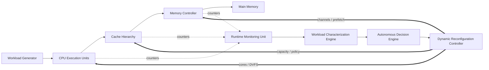

# Self-Evolving Computer Architecture
### Autonomous Runtime Optimization and Dynamic Reconfiguration Simulator

A discrete-time simulator of a computer system that **monitors its own behaviour at
run time, characterises the running workload, decides autonomously how its
hardware resources should be configured, and reconfigures itself while the
program keeps running**. It runs side by side with a conventional static
architecture on the identical workload. An interactive Streamlit + Plotly
dashboard shows the architecture evolving.

Every number in the dashboard is computed by the simulation engine from
architectural equations. There are no random performance boosts, hard-coded
improvements or scripted event logs.

---

## Contents
1. [Problem statement](#1-problem-statement)
2. [Proposed architecture](#2-proposed-architecture)
3. [Component descriptions](#3-component-descriptions)
4. [Data flow](#4-data-flow)
5. [Mathematical models](#5-mathematical-models-and-equations)
6. [Decision-making algorithm](#6-decision-making-algorithm)
7. [Reconfiguration mechanism and overhead](#7-reconfiguration-mechanism-and-overhead)
8. [Simulation scenarios](#8-simulation-scenarios)
9. [Performance evaluation](#9-performance-evaluation)
10. [Installation and execution](#10-installation-and-execution)
11. [Project structure](#11-project-structure)
12. [Static vs self-evolving design](#12-how-this-differs-from-a-conventional-static-architecture)
13. [Limitations and assumptions](#13-limitations-and-assumptions)

---

## 1. Problem statement

A conventional processor is designed around a fixed operating point: core
count, clock frequency, cache capacity and memory-channel count are chosen at
design time for an "average" program. Real programs move through **phases**.
A matrix multiply is limited by arithmetic throughput, while a database scan is
limited by memory bandwidth and latency. A fixed design is over-provisioned in
one phase and under-provisioned in the next, and it wastes power in both.

The goal is an architecture that:

* observes hardware performance counters at run time,
* infers whether the workload is compute-bound, memory-bound or balanced,
* chooses a better resource configuration within a power budget,
* applies it **without restarting** the workload, paying a realistic
  adaptation cost, and
* decides *not* to adapt when the cost would outweigh the benefit.

## 2. Proposed architecture

```
                         DATA PATH (instructions & memory traffic)
 ┌────────────┐   ┌──────────────────┐   ┌────────────────┐   ┌──────────────┐   ┌────────────┐
 │  Workload  │──▶│ CPU Exec. Units  │──▶│ Cache Hierarchy│──▶│  Memory Ctrl │──▶│ Main Memory│
 │ Generator  │   │ 1-8 cores, 1-4GHz│   │ L1 + LLC 256K- │   │ 1-4 channels │   │ DRAM       │
 └────────────┘   └──────────────────┘   │ 4M, LRU/FIFO   │   │ prefetcher   │   └────────────┘
                     ┊   ▲               └────────────────┘   └──────────────┘
          counters   ┊   │ reconfiguration    ┊   ▲                ┊   ▲
                     ▼   │ commands           ▼   │                ▼   │
 ┌──────────────────────────────────────────────────────────────────────────────────────────┐
 │ Runtime Monitoring ─▶ Workload Characterization ─▶ Autonomous Decision ─▶ Reconfiguration │
 │      Unit (PMU)            Engine (classifier)          Engine (optimiser)    Controller   │
 └──────────────────────────────────────────────────────────────────────────────────────────┘
                         CONTROL PATH (observe → classify → decide → act)
```



### Reconfigurable resources

| Resource | Range | Mechanism modelled |
|---|---|---|
| CPU cores | 1 – 8 | power gating + thread migration |
| CPU frequency | 1.0 – 4.0 GHz (0.5 steps) | DVFS (PLL relock, voltage ramp) |
| LLC capacity | 256 KB – 4 MB | way enable/disable, dirty write-back on shrink |
| Memory channels | 1 – 4 | self-refresh exit, address-interleave remap |
| Prefetcher | on / off | stream prefetcher enable |
| Replacement policy | LRU / FIFO | policy-bit switch |

## 3. Component descriptions

| Component | File | Responsibility |
|---|---|---|
| Workload Generator | `simulation/workload_generator.py` | Sequence of phases (compute / memory / mixed). A phase is an amount of **work** (instructions), so faster hardware finishes it sooner. Each kind has ground-truth characteristics (memory refs/instr, working set, base CPI, parallel fraction, MLP, stream fraction, locality). Optional seeded noise. |
| CPU Execution Units | `simulation/cpu.py` | Amdahl scaling across cores, frequency scaling, LLC-hit latency exposure. |
| Cache Hierarchy | `simulation/cache.py` | Stateful LLC: resident (warm) data, miss curve, LRU/FIFO, prefetch coverage, accuracy and pollution, warm-up, phase-change invalidation, resize with dirty flush. |
| Memory Controller + DRAM | `simulation/memory_controller.py` | Channel bandwidth, utilisation, queueing latency, queue occupancy (Little's law). |
| Performance model | `simulation/performance_model.py` | Couples CPU ↔ cache ↔ memory and solves the self-consistent operating point. |
| Power model | `simulation/power_model.py` | Core static and dynamic (V²f) power, cache leakage, channel and prefetcher power. |
| Runtime Monitoring Unit | `simulation/runtime_monitor.py` | PMU model. Accumulates counters and emits a `Sample` every *sampling interval* steps, charging monitoring overhead. |
| Workload Characterization Engine | `simulation/workload_classifier.py` | Threshold rules with hysteresis bands and consecutive-sample validation. |
| Performance predictor | `simulation/performance_predictor.py` | Predicts candidate-config throughput **from counters only** (never sees the ground-truth workload). |
| Autonomous Decision Engine | `simulation/decision_engine.py` | Policy-constrained search within a power budget, then a cost/benefit gate. |
| Dynamic Reconfiguration Controller | `simulation/reconfiguration_controller.py` | Applies changes over time: latency, transitional resources, throughput penalty, energy, records. |
| Simulation engine | `simulation/engine.py` | Discrete-time loop that wires everything together and produces the history and event log. |
| Static baseline | `simulation/baseline_architecture.py` | The same engine with the adaptive path disabled, so the workload and equations are identical. |
| Analysis | `simulation/analysis.py` | Static vs adaptive comparison and overhead sweeps. |
| Scenarios | `simulation/scenarios.py` | Six predefined scenarios, plus custom ones from the UI. |
| Dashboard | `app.py`, `visualization/*` | Rendering only; reads engine state. |

## 4. Data flow

Each engine step simulates `step_cycles` reference cycles (default 10 000; 1 reference cycle = 1 ns):

1. **Workload Generator** supplies the current phase's characteristics.
2. **Reconfiguration Controller** splits the step into segments: normal,
   transitional (a reconfiguration is in flight) and post-reconfiguration.
3. **Performance model** evaluates each segment: CPU → LLC → memory controller →
   DRAM, then back to the CPU through the latency feedback loop.
4. Instructions are retired, the cache warms up, and the workload advances. A
   crossed phase boundary invalidates most of the cache's useful contents.
5. A reconfiguration that finished this step is committed: the new configuration
   becomes architectural state, the cache is resized and the policy switched.
6. **Runtime Monitor** accumulates the step's counters. Every *N* steps it closes
   a sample (monitoring overhead charged).
7. **Classifier → Decision Engine → Reconfiguration Controller** (adaptive only).
   Decision overhead is charged when the optimiser runs.

Monitoring and decision overheads are "stolen" from the next step's execution time.

## 5. Mathematical models and equations

All constants live in `config/default_config.py`.

### 5.1 CPU
* Amdahl speed-up with parallel fraction *p*: **S(n) = 1 / ((1 − p) + p/n)**
* LLC accesses per instruction: **A = mem_ratio · (1 − L1_hit)**
* LLC hit latency (bigger is slower): **H(C) = 10 + 3·log₂(C / 256 KB)** core cycles
* Execution time per instruction, per thread (ns):
  **t_exec = [CPI_exec + A·(1 − m)·H(C)·e_hit] / f**, with *e_hit = 0.35* the part of hit
  latency out-of-order execution cannot hide.

### 5.2 Cache (LLC)
* Coverage of the working set *W* by resident data *R*: **cov = min(1, R/W)**
* Miss curve (power law, "√2 rule"): **m = m_min + (m_base − m_min)·(1 − √cov)**
* FIFO vs LRU, with temporal locality *L_t*: **m_FIFO = m·(1 + 0.15·(L_t − 0.4))**
  (LRU wins for high reuse; FIFO is equal or better for streaming scans).
* Prefetcher, with stream fraction *s*: coverage **c = 0.8·s**, accuracy **a = 0.5 + 0.4·s**,
  pollution **m ← m·(1 + 0.06·(1 − s))**, exposed misses **m_exp = m·(1 − c)**,
  extra traffic **m·c·(1/a − 1)**
* Warm-up: each demand miss installs its 128 B sector pair, **R ← min(min(C, W), R + fetched)**.
  At a phase change, **R ← R·overlap** (overlap = 0.1).
* Resize: growing adds cold capacity. Shrinking evicts, and the dirty part is written back.

### 5.3 Memory controller and DRAM
* Peak bandwidth: **B = 12.8 GB/s × channels** (DDR4-1600, 64-bit)
* Traffic per instruction: **b = A·64 B·(m + extra)·(1 + 0.5·write_fraction)**
* Utilisation: **ρ = X·b / B**
* Loaded latency (queueing): **L(ρ) = 75 + 30·ρ/(1 − ρ) ns**
* Queue occupancy (Little's law): **N = (X·b/64)·L**, utilisation = N / (32·channels)

### 5.4 Coupled operating point
Throughput *X* (instructions/ns, all cores) depends on latency, latency depends on
bandwidth demand, and demand depends on throughput:

**X = S(n) / ( t_exec + A·m_exp·L(X·b/B) / MLP )**

The right-hand side decreases monotonically in *X*, so the unique fixed point is
found by bisection. If it lies beyond 97 % bus utilisation, the workload is
**bandwidth-bound** and **X = 0.97·B/b**.

Derived metrics:

| Metric | Equation |
|---|---|
| IPC (system) | X / f |
| IPC per core | X / (f·n) |
| CPU utilisation | (S/n) · t_exec / (t_exec + t_mem) (non-stalled, non-idle core time) |
| Memory-stall fraction | t_mem / (t_exec + t_mem) |
| Resource utilisation | mean(CPU util, BW util, cache occupancy R/C) |
| Instructions per step | X · step_cycles · (reconfiguration factor) · (1 − overhead fraction) |
| Execution time | cycles until all work is retired (the final step is fractional) |

### 5.5 Power and energy
* **V(f) = 0.6 + 0.15·f**
* **P_core = 0.8 + 1.6·f·V²·(0.35 + 0.65·u)** (per powered core, *u* = utilisation)
* **P = n·P_core + 1.0 W/MB·C + channels·(1.5 + 2.5·ρ) + 0.4·[prefetch]**
* Energy = Σ P·Δt + reconfiguration energy. Candidate configurations must satisfy
  **P_peak ≤ power budget** (default 45 W).

The power budget makes the problem a real trade-off. Without it, "maximise every
resource" would always win.

## 6. Decision-making algorithm

### 6.1 Classification (`workload_classifier.py`)
| Class | Rule (per sample) |
|---|---|
| Compute-bound | CPU ≥ 0.60 **and** BW ≤ 0.35 **and** LLC miss ≤ 0.15 |
| Memory-bound | CPU ≤ 0.40 **and** miss ≥ 0.30 **and** (BW ≥ 0.45 **or** DRAM-stall ≥ 0.55) |
| Balanced | otherwise |

Anti-oscillation:
* **Hysteresis bands.** Thresholds of the *current* class are relaxed by 0.05.
* **Consecutive-sample validation.** A new class needs `confirm_samples` (2)
  agreeing samples in a row.
* **Discarded samples.** Samples overlapping a reconfiguration, and the first two
  warm-up samples, are ignored.

The workload profiles were calibrated so that each phase is classified correctly
**under every policy configuration**. Adapting to a phase therefore never makes it
look like a different phase, which is a classic source of oscillation.

### 6.2 Trigger
The optimiser runs only when:
1. the validated class changes,
2. IPC drifts by more than 15 % while samples still agree with the class, or
3. once after a reconfiguration (**closed-loop refinement**), using counters measured
   on the new configuration. This corrects prediction error.

### 6.3 Policy-constrained optimisation
Each class defines a search space (`POLICY_SPACE`):

| Class | Cores | Freq (GHz) | LLC | Channels | Prefetch | Policy |
|---|---|---|---|---|---|---|
| Compute-bound | 4–8 | 2.5–4.0 | 256 K–1 M | 1–2 | off | LRU |
| Memory-bound | 2–8 | 1.0–2.5 | 2–4 M | 3–4 | on | FIFO |
| Balanced | 4–6 | 2.0–3.0 | 1–4 M | 2–3 | on | LRU |

Every candidate within the power budget is scored with the **counter-based predictor**:

* parallel fraction from the busy-core ratio (inverse Amdahl),
* MLP from the measured CPI stack, **MLP = A·m_exp·L / t_mem**,
* miss rate for a new capacity with the √2 rule, **m₁ = m₀·(C₁/C₀)^−0.5**,
* prefetch coverage from the stream detector's counter,
* the same memory feedback solver (a hardware property).

Among candidates within 3 % of the best predicted throughput, the one with the
**lowest peak power** is chosen. This gives near-optimal performance at minimum
power. If the current configuration is in that set, it is kept.

### 6.4 Cost/benefit gate
```
gain   = X_target / X_current − 1
H      = learnt mean phase residency (EMA of observed class durations, prior 50 steps)
saved  = H · step_cycles · (1 − X_current / X_target)
cost   = duration · (1 − factor · X_transitional / X_target)   (lost cycles vs an instant switch)
reconfigure  ⇔  gain ≥ min_gain (5 %)  AND  saved ≥ margin (1.25) × cost
```
When phases are short, *H* shrinks, so the same reconfiguration stops paying off and
the engine holds. A **naive** mode (no hysteresis, sampling every step, first
sample accepted, no cost gate) is included for comparison.

## 7. Reconfiguration mechanism and overhead

| Change | Latency (cycles) | Throughput during | Energy |
|---|---|---|---|
| Frequency (DVFS) | 15 000 | ×0.50 | 6 µJ |
| Cores (gating + migration) | 40 000 | ×0.60 | 12 µJ + 3 µJ/core |
| LLC capacity | 5 000 + flush | ×0.70 | 4 µJ + 20 µJ/MB flushed |
| Memory channels (remap) | 50 000 | ×0.50 | 15 µJ |
| Prefetcher | 500 | ×0.95 | 0.2 µJ |
| Replacement policy | 2 000 | ×0.90 | 0.5 µJ |

* Components switch in parallel: **duration = 2 000 + max(latencyᵢ) + flush time**,
  where **flush = dirty bytes / (channels·12.8 GB/s)**.
* During the transition the machine runs on the **transitional configuration**
  (only resources common to old and new configurations, e.g. min(cores)) at
  **min(factorᵢ)** throughput.
* **Lost cycles** are the extra time compared with an *ideal instantaneous* switch,
  measured step by step: **lost = Σ Δt · (1 − factor · X_transitional / X_new)**.
  They include both the throughput penalty and running on reduced resources. A test
  (`test_overhead_matches_instantaneous_counterfactual`) checks this against a run
  in which reconfiguration really is instantaneous.
* Workload position, retired instructions and warm cache contents are preserved.
  Nothing restarts. The new configuration is committed at the completion cycle.
* Each record stores start/completion cycle, previous and new configuration,
  duration, lost cycles, energy and the predicted gain.

**Adaptation overhead** = reconfiguration lost cycles + monitoring (150 + 50 cycles
per sample) + decision-making (400 + 4 cycles per candidate evaluated).

**Total effective execution time = normal execution time + adaptation overhead**

**Performance improvement (%) = (T_static − T_adaptive) / T_static × 100**

## 8. Simulation scenarios

Phase sizes are chosen so that each long phase takes about 100 steps on the static
baseline, which reproduces the "0–100 / 100–200 / 200–300" structure of the brief.

| # | Scenario | Workload | Purpose |
|---|---|---|---|
| 1 | Static compute-intensive | compute × 300 steps | baseline; adapt once and stay |
| 2 | Static memory-intensive | memory × 300 steps | memory-side optimisation |
| 3 | **Dynamic transition** | compute → memory → mixed | main demonstration |
| 4 | Adaptive vs static | compute → memory → mixed → compute → memory | recurring phases |
| 5 | Rapid switching | 24 alternating phases of ~6 steps | adaptation not worth it |
| 6 | Very short workload | ~15 steps in total | adaptation not worth it |
| 7 | Custom | edited in the sidebar | anything |

The static baseline (default) is **4 cores @ 3.0 GHz, 1 MB LRU LLC, 2 channels,
prefetch off**. The adaptive system starts from the same configuration.

## 9. Performance evaluation

Results from `python run_scenarios.py --sweeps` (default parameters, no noise):

| Scenario | Static cycles | Adaptive cycles | Improvement | IPC static → adaptive | Reconfigs | Overhead | Energy | Naive adaptive |
|---|---:|---:|---:|---:|---:|---:|---:|---:|
| 1. Static compute | 3 001 423 | 2 249 356 | **+25.1 %** | 7.33 → 11.62 | 1 | 2.17 % | −9.5 % | +29.8 % (1) |
| 2. Static memory | 3 072 224 | 1 544 914 | **+49.7 %** | 0.78 → 2.28 | 2 | 4.82 % | −22.0 % | +51.0 % (2) |
| 3. Dynamic transition | 2 996 137 | 2 174 233 | **+27.4 %** | 3.60 → 5.79 | 4 | 5.88 % | −4.3 % | +32.2 % (5) |
| 4. Adaptive vs static | 5 015 449 | 3 545 157 | **+29.3 %** | 3.78 → 6.33 | 7 | 6.09 % | −6.3 % | +34.4 % (9) |
| 5. Rapid switching | 1 148 946 | 1 167 677 | **−1.6 %** | 5.10 → 5.77 | 2 | 5.50 % | +21.8 % | **−77.3 %** (23) |
| 6. Very short | 168 848 | 170 942 | **−1.2 %** | 3.81 → 3.76 | 0 | 0.35 % | +1.1 % | +35.0 % (0) |

### Event log of Scenario 3 (produced by the engine)
```
      200,000  Workload classified as Compute-bound (CPU 86% high, memory BW 2% low, LLC miss 4% low)
      200,000  Decision: reconfigure - Compute-bound: predicted +47.9%, saves ~161,845 cycles vs cost 38,837
      200,000  CPU core allocation increased from 4 to 8
      200,000  CPU frequency decreased from 3.0 GHz to 2.5 GHz    (power budget: more cores beat higher f)
      200,000  LLC capacity decreased from 1 MB to 256 KB
      200,000  Memory channels decreased from 2 to 1
      260,000  Reconfiguration #1 complete in 53,791 cycles (lost 38,822 cycles, 49.4 uJ, flushed 26 KB)
      830,000  Workload changed to phase 2: Memory-intensive
      950,000  Workload classified as Memory-bound (CPU 5% low, memory BW 87%, LLC miss 87%, DRAM stalls 91%)
      950,000  Decision: reconfigure - Memory-bound: predicted +329.5%
      950,000  CPU frequency decreased from 2.5 GHz to 2.0 GHz; LLC 256 KB -> 2 MB; channels 1 -> 3;
               prefetcher enabled; replacement policy LRU -> FIFO
    1,150,000  Decision: reconfigure - Memory-bound (refinement): predicted +23.2%  (LLC 2 MB -> 4 MB)
    1,450,000  Workload changed to phase 3: Mixed
    1,550,000  Workload classified as Balanced (CPU 39%, memory BW 14%, LLC miss 38%)
    1,550,000  Decision: reconfigure - Balanced: predicted +7.5%, saves ~42,868 vs cost 32,696
                                        (5 cores @ 3.0 GHz, 2 channels, LRU)
    1,750,000  Decision engine holds configuration: current configuration is already optimal for Balanced
```

### When adaptation is *not* beneficial
**Frequent switching** (alternating compute/memory, same total work, cut into shorter phases):

| Phase length (baseline steps) | Cost-aware | Naive |
|---:|---:|---:|
| 120 | +29.5 % (3 reconf) | +36.9 % (3) |
| 30 | +7.8 % (8) | +19.4 % (15) |
| 15 | +8.6 % (6) | +6.0 % (20) |
| 10 | +4.5 % (4) | −7.7 % (23) |
| 6 | +2.1 % (2) | **−79.4 % (39)** |

**Short workloads** (a single compute phase): 4–12 steps give about −0.2 % (the
engine cannot even classify before the program ends; only monitoring overhead
remains). At **20 steps it is −14 %** (overhead 15.8 %): the reconfiguration's cost is paid but
cannot be amortised. Adaptation breaks even at about 30–40 steps and reaches
+23.5 % at 200 steps.

### Interpretation
* On long phases, adaptation gives +25–50 % performance and −4 to −22 % energy.
  The adaptive system is faster *and* uses less energy, because it powers what the
  phase needs (e.g. 2 GHz cores while waiting on DRAM).
* Adaptation always costs something: 2.2–6.1 % of execution time here. The decision
  engine's cost predictions track the measured losses closely (38.8 k predicted vs
  38.8 k measured for the first reconfiguration of Scenario 3).
* The cost-aware engine pays for its caution. On long phases the naive engine, which
  samples every step, reacts sooner and is a few percent faster. Under rapid
  switching the naive engine thrashes (23–39 reconfigurations, up to −79 %), while
  the cost-aware engine recognises the alternating mix as one balanced workload and
  stays within ±2 % of static. This is the classic responsiveness/stability
  trade-off.
* Resource utilisation is higher with adaptation because over-provisioned resources
  (e.g. a 1 MB LLC for a 384 KB working set) are released.

## 10. Installation and execution

Requirements: Python 3.10+. No GPU needed.

```bash
python -m venv .venv
source .venv/bin/activate          # Windows: .venv\Scripts\activate
pip install -r requirements.txt

streamlit run app.py               # interactive dashboard (http://localhost:8501)
python run_scenarios.py --sweeps   # headless: all scenarios + overhead sweeps
python run_scenarios.py --events   # headless: with full event logs
pytest -q                          # unit tests
```

### Using the dashboard
* **Sidebar:** scenario, phase editor (Custom), sampling interval, confirmation
  samples, minimum gain, benefit margin, power budget, cost-aware/hysteresis toggles,
  cycles per step, noise, static/initial configuration, playback speed.
  Changing any setting resets the simulation.
* **Controls:** Start, Pause, Resume, Step, Run to end, Reset.
* **Tabs:**
  * *Architecture* – live block diagram (cores, cache fill and channels update on
    reconfiguration; border colours show normal/monitoring/decision/reconfiguring/overhead),
    live metrics and the latest events.
  * *Performance* – CPU utilisation, memory bandwidth, IPC, hit rate, classification
    and latency over time, plus configuration over time. Reconfigurations are shaded
    and phase transitions are marked.
  * *Static vs Adaptive* – improvement, net/gross benefit, overhead, energy,
    per-metric comparison and work-completed curves.
  * *Adaptation overhead* – breakdown, reconfiguration records, decision log, and
    on-demand sweeps (frequent switching, short workloads, naive vs cost-aware).
  * *Event log* – filterable and downloadable.
  * *Model & equations*.

## 11. Project structure
```
app.py                        Streamlit dashboard (UI only)
run_scenarios.py              headless scenario runner
config/default_config.py      every constant, threshold, cost and profile
simulation/
  models.py                   data types (ArchConfig, Sample, StepRecord, ...)
  workload_generator.py       phases and characteristics
  cpu.py  cache.py  memory_controller.py  power_model.py
  performance_model.py        coupled operating-point solver
  performance_predictor.py    counter-based predictor (decision side)
  runtime_monitor.py          PMU / sampling
  workload_classifier.py      characterisation with hysteresis
  decision_engine.py          policy, optimiser, cost/benefit gate
  reconfiguration_controller.py
  engine.py                   discrete-time simulation loop
  baseline_architecture.py    static architecture (same engine, adaptation off)
  scenarios.py  analysis.py
visualization/
  theme.py  architecture_diagram.py  metrics_dashboard.py  performance_charts.py
tests/                        43 unit and integration tests
```

## 12. How this differs from a conventional static architecture

| | Static architecture | Self-evolving architecture |
|---|---|---|
| Configuration | fixed at design time | changes at run time, per phase |
| Knowledge of workload | none | PMU counters → classification → prediction |
| Memory-bound phase | cores at full frequency stall on DRAM; one LLC size, 2 channels | lower frequency, more channels, bigger LLC, prefetching |
| Compute-bound phase | memory resources idle but powered | power moved from memory/cache to cores |
| Power budget | spent the same way always | re-allocated to the bottleneck |
| Overheads | none | monitoring, decisions, reconfiguration latency and energy |
| Risk | under/over-provisioning | thrashing; mitigated by hysteresis and the cost/benefit gate |

## 13. Limitations and assumptions

* **Analytical, not cycle-accurate.** Throughput comes from a CPI-stack model with
  a queueing-theory memory model, not instruction-level simulation. One engine step
  aggregates 10 000 reference cycles.
* **Synthetic workloads.** Phases are parameterised profiles, not traces of real
  programs. Phase lengths are about 1 ms, much shorter than real program phases, so
  warm-up and reconfiguration costs are relatively large. That is deliberate, so
  the overhead is visible.
* **Shared LLC only.** L1 is fixed; there is no explicit L2, coherence or NUMA model.
* **Simplified cache warm-up.** Resident data is tracked as an amount, not
  per-line; a phase change keeps 10 % of useful contents.
* **Approximate costs.** Reconfiguration latencies and energies are plausible
  orders of magnitude (DVFS tens of µs, core migration and channel remap tens of
  µs), not measurements of a specific chip.
* **Approximate predictor.** The √2 miss rule over-estimates gains when the working
  set is much larger than the cache. Closed-loop refinement corrects this after the
  first reconfiguration.
* **Workload ignorance.** The decision side never reads the ground-truth workload
  parameters; it uses counters only. The hardware constants (DRAM latency curve,
  channel bandwidth, power model) are assumed known to the controller.
* **Deterministic by default.** Noise is optional and seeded identically for the
  static and adaptive runs.
